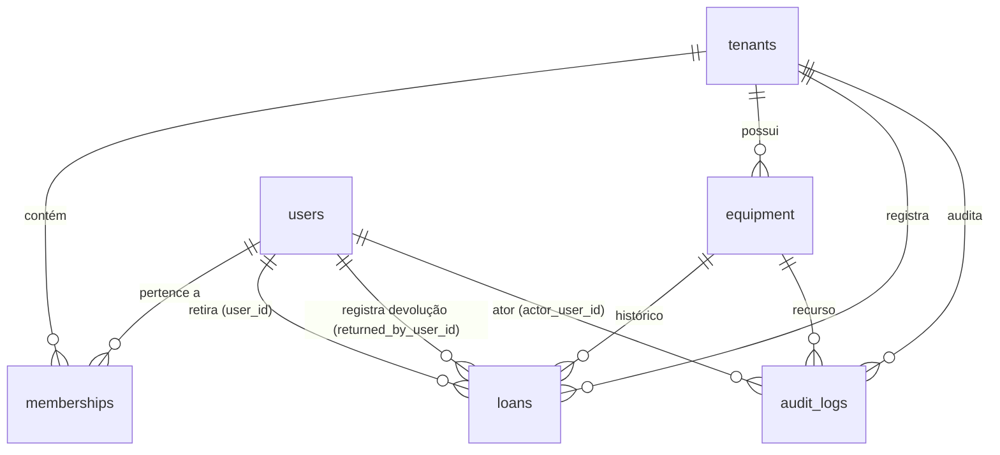

# Modelagem do banco — EMPREST.AI

Status: **aprovado em 2026-10-19** (respostas 1–6 = rascunho). Implementado em `back/prisma/`. Histórico: o `schema.prisma` só nasceu em
`back/` depois que este documento for aprovado (`rules/restrictions.md`).

Fontes: `docs/PRD.md` (v1), `docs/adr/001-stack.md`, `layout.md`.
Nada aqui cria decisão de ADR; onde o ADR não decidiu (modelagem é
expressamente dele), a escolha está marcada e as dúvidas estão na seção 10.

---

## 1. Escopo e convenções

- Banco único, multi-tenant por coluna: `tenant_id` em toda tabela de domínio
  (ADR 001). O primeiro tenant, `suporte_ti`, vem do seed.
- Prisma Migrate é o **único** dono do schema. Tudo que o Prisma não expressa
  (trigger do Supabase Auth, índices parciais, CHECKs compostos, RLS, tabela de
  rate limit) entra como SQL bruto **dentro das migrations do Prisma**.
- Nome de tabela `snake_case` no banco (`@@map`), modelo Prisma `PascalCase`;
  coluna `snake_case` (`@map`), campo `camelCase`.
- Ids: `uuid` (`gen_random_uuid()`).
- Timestampos: `timestamptz`. Prazo de devolução: `date` — o sistema opera por
  dia, não por hora (datas exibidas como `DD/MM/AAAA`).
- Usuários: Supabase Auth é a fonte. `public.users` é um **espelho**
  (id = `auth.users.id`), mantido por trigger; a API nunca escreve em
  `auth.users`.
- Fora do escopo desta versão (e portanto sem tabela): reserva com data futura,
  notificação por e-mail, importação da planilha, sessão no servidor (o token
  vai no header), provisionamento de tenant/convite.

## 2. Diagrama



`auth.users` (Supabase) se relaciona com `public.users` por FK criada em SQL
bruto — está fora do alcance do Prisma e por isso não aparece no diagrama.

## 3. Enums

| Tipo no banco | Valores | Uso |
|---|---|---|
| `role` | `COLABORADOR`, `OPERACOES` | `memberships.role` (papéis do `layout.md` §6). Ver pergunta 1 — ADR menciona "administrador" no convite. |
| `equipment_category` | `NOTEBOOK`, `MONITOR`, `CABO`, `CAMERA`, `ACESSORIO` | select do cadastro (`layout.md` §5.5). |
| `equipment_status` | `DISPONIVEL`, `EMPRESTADO`, `MANUTENCAO` | situação do equipamento. `EMPRESTADO` é derivada de empréstimo aberto, mas fica como coluna (ver §6). |

`action` e `resource_type` da auditoria ficam como `text` por enquanto: ainda
não existe lista fechada de ações (pergunta 6).

## 4. Tabelas de domínio

Exceto `users` (espelho global do Supabase Auth), toda tabela abaixo carrega
`tenant_id` e só é enxergada dentro do próprio tenant (seção 8). O vínculo de
um usuário a um tenant acontece via `memberships`.

### 4.1 `tenants`

Tabela-pai. Não tem `tenant_id`.

| Coluna | Tipo | Restrição |
|---|---|---|
| `id` | `uuid` | PK, default `gen_random_uuid()` |
| `slug` | `text` | NOT NULL, UNIQUE (`suporte_ti`) |
| `name` | `text` | NOT NULL |
| `created_at` | `timestamptz` | NOT NULL, default `now()` |

Índice: UNIQUE em `slug`.

### 4.2 `users` (espelho do Supabase Auth)

| Coluna | Tipo | Restrição |
|---|---|---|
| `id` | `uuid` | PK — **sem default**: recebe o id de `auth.users` |
| `email` | `text` | NOT NULL |
| `name` | `text` | NOT NULL |
| `created_at` | `timestamptz` | NOT NULL, default `now()` |
| `updated_at` | `timestamptz` | NOT NULL, default `now()` |

- FK `id → auth.users(id) ON DELETE CASCADE` e trigger de
  `INSERT/UPDATE` em `auth.users` que mantêm `email` e `name` em sincronia:
  SQL bruto (Apêndice B). O `name` vem de
  `raw_user_meta_data->>'name'` com fallback para o e-mail — o fluxo de convite
  ainda não está decidido (pergunta 7).
- Índice: UNIQUE em `id` (PK já garante); índice simples em `email` para busca.

### 4.3 `memberships`

Vínculo usuário–tenant, exatamente a tripla decidida no ADR 001
(`user_id, tenant_id, role`). Própria `tenant_id` já é a coluna de domínio.

| Coluna | Tipo | Restrição |
|---|---|---|
| `id` | `uuid` | PK, default `gen_random_uuid()` |
| `tenant_id` | `uuid` | NOT NULL, FK → `tenants.id` `ON DELETE CASCADE` |
| `user_id` | `uuid` | NOT NULL, FK → `users.id` `ON DELETE CASCADE` |
| `role` | `role` | NOT NULL |
| `created_at` | `timestamptz` | NOT NULL, default `now()` |

Restrições e índices:
- UNIQUE `(user_id, tenant_id)` — uma pessoa entra uma vez por tenant, com um
  papel por vez.
- Índice `(tenant_id)`.

### 4.4 `equipment`

Um **item físico** do catálogo (notebook, monitor, cabo, câmera, acessório) —
não um modelo, cada patrimônio é uma linha.

| Coluna | Tipo | Restrição |
|---|---|---|
| `id` | `uuid` | PK, default `gen_random_uuid()` |
| `tenant_id` | `uuid` | NOT NULL, FK → `tenants.id` `ON DELETE RESTRICT` |
| `name` | `text` | NOT NULL (obrigatório no formulário, `layout.md` §7.10) |
| `category` | `equipment_category` | NOT NULL |
| `patrimonio` | `text` | NULL (vazio cai para `TI-——` na tela) |
| `status` | `equipment_status` | NOT NULL, default `DISPONIVEL` |
| `observacao` | `text` | NULL — textos como "Painel com falha, retorna em 05/09" |
| `created_at` | `timestamptz` | NOT NULL, default `now()` |
| `updated_at` | `timestamptz` | NOT NULL, default `now()` |

Restrições e índices:
- UNIQUE `(tenant_id, patrimonio)` — no Postgres linhas com `patrimonio NULL`
  não colidem, então dá para cadastrar item sem patrimônio.
- Índice `(tenant_id, status)` — filtros do catálogo e KPIs.
- Índice `(tenant_id, created_at DESC)` — paginação por cursor (decidida no
  ADR 001) e o "item entra no topo da lista".
- Formato do patrimônio (`TI-####`): validado no Zod da API; não há CHECK no
  banco (pergunta 4).
- `name` não é único — podem existir dois "Cabo HDMI 2.1 3m"; o patrimônio é
  que identifica.

### 4.5 `loans`

Uma linha = **um item com uma pessoa**, de ponta a ponta. Empréstimo fechado
nunca é apagado — é histórico (a tela de Operações filtra os abertos).

| Coluna | Tipo | Restrição |
|---|---|---|
| `id` | `uuid` | PK, default `gen_random_uuid()` |
| `tenant_id` | `uuid` | NOT NULL, FK → `tenants.id` `ON DELETE RESTRICT` |
| `equipment_id` | `uuid` | NOT NULL, FK → `equipment.id` `ON DELETE RESTRICT` |
| `user_id` | `uuid` | NOT NULL, FK → `users.id` `ON DELETE RESTRICT` — quem está com o item |
| `opened_at` | `timestamptz` | NOT NULL, default `now()` — "Retirada" |
| `due_at` | `date` | NOT NULL — "Devolver até" = data da retirada + 14 dias |
| `returned_at` | `timestamptz` | NULL — preenchido na devolução; aberto ⇔ NULL |
| `returned_by_user_id` | `uuid` | NULL, FK → `users.id` `ON DELETE SET NULL` — quem registrou (o próprio ou Operações no balcão) |

Restrições e índices:
- CHECK `((returned_at IS NULL) = (returned_by_user_id IS NULL))` — ou os dois
  vazios (aberto) ou os dois preenchidos (fechado). SQL bruto.
- **Índice único parcial** `(tenant_id, equipment_id) WHERE returned_at IS
  NULL` — garantia dura de que um item nunca está com duas pessoas ao mesmo
  tempo.
- Índice parcial `(tenant_id, user_id) WHERE returned_at IS NULL` — "meus
  empréstimos" e a contagem do limite de 3.
- Índice parcial `(tenant_id, due_at) WHERE returned_at IS NULL` — atraso e
  ordenação por prazo em Operações.
- Índice `(tenant_id, opened_at DESC)` — histórico e cursor.
- `ON DELETE RESTRICT` nas três FKs de domínio: apagar item, pessoa ou tenant
  com histórico falha — exclusão não faz parte da v1 (ver nota no Apêndice A).

### 4.6 `audit_logs`

Auditoria append-only com ator, tenant, ação e recurso — conteúdo decidido no
ADR 001.

| Coluna | Tipo | Restrição |
|---|---|---|
| `id` | `uuid` | PK, default `gen_random_uuid()` |
| `tenant_id` | `uuid` | NOT NULL, FK → `tenants.id` |
| `actor_user_id` | `uuid` | NULL, FK → `users.id` `ON DELETE SET NULL` — NULL = sistema/seed |
| `action` | `text` | NOT NULL — ex.: `loan.open`, `loan.return`, `equipment.create`, `equipment.status_change` |
| `resource_type` | `text` | NOT NULL — `equipment`, `loan`, `membership` |
| `resource_id` | `uuid` | NOT NULL |
| `created_at` | `timestamptz` | NOT NULL, default `now()` |

- Índices: `(tenant_id, created_at DESC)` e
  `(tenant_id, resource_type, resource_id)`.
- Append-only garantido por trigger que bloqueia `UPDATE` e `DELETE` (Apêndice
  B). Consequência: o `SET NULL` de `actor_user_id` também seria bloqueado,
  então excluir um usuário que é ator de auditoria falha — exclusão de usuário
  não existe na v1 (pergunta 7).

## 5. Tabelas de infraestrutura (não são domínio)

### 5.1 `rate_limit_counters`

Contador por IP e por usuário, decisão do ADR 001 (`@nestjs/throttler` em
memória não funciona em serverless). Criada só em SQL bruto — não vira modelo
Prisma e não tem `tenant_id`.

| Coluna | Tipo | Restrição |
|---|---|---|
| `key` | `text` | PK — `ip:<ip>` ou `user:<uuid>` |
| `window_started_at` | `timestamptz` | NOT NULL |
| `hits` | `integer` | NOT NULL, default `0` |

### 5.2 `auth.*`

O schema `auth` é do próprio Supabase (usuários, tokens) e não é gerenciado
pelo Prisma. A API só valida o JWT via JWKS e mantém o espelho `public.users`.

## 6. Regras de negócio e onde cada uma é garantida

| Regra (PRD) | Garantia |
|---|---|
| Máx. 3 itens simultâneos por pessoa | **Serviço**, na transação de abertura: contar empréstimos abertos do usuário no tenant com lock e recusar com 409. Não é expressável em `CHECK`; se um dia quiser garantia no banco, o caminho é trigger (fora da v1). |
| Prazo padrão de 14 dias | **Serviço**: `due_at = opened_at::date + 14` no ato da abertura. Sem `CHECK` de data no banco, para que o prazo possa virar configurável depois sem migration. |
| Quem tem item em atraso não pega outro | **Serviço**: `EXISTS` empréstimo aberto do usuário com `due_at < current_date` → recusa a abertura; o front exibe o banner "Bloqueado por atraso". |
| Equipamento em manutenção não aparece como disponível | **Banco + serviço**: coluna `equipment.status`; o catálogo só trata `DISPONIVEL` como disponível e a abertura exige `status = DISPONIVEL`. |
| Um item só pode estar em um empréstimo aberto | **Banco**: índice único parcial (§4.5). |
| `status = EMPRESTADO` ⇔ existe empréstimo aberto | **Serviço**: coluna atualizada na mesma transação que abre/fecha o empréstimo. O índice único parcial impede o caso grave (dois empréstimos abertos); divergência restante é bug de código e é detectável por query de conferência. |
| Item em manutenção não pode estar emprestado | **Serviço** na v1 — ver pergunta 3 (o fluxo natural é devolver e só então mandar para manutenção). |
| Colaborador vê só os próprios empréstimos; Operações vê todos | **API**: filtro por `user_id` no escopo Colaborador; papel `OPERACOES` enxerga tudo do tenant. Teste obrigatório de isolamento por endpoint (ADR 001). |

Todas as queries levam o `tenant_id` vindo do contexto de request (claim do
JWT, `AsyncLocalStorage`), nunca do body.

## 7. Derivações de tela — nada disso vira coluna

- **Situação do empréstimo** (pill): `EM ATRASO` se `due_at < current_date`;
  senão `EM DIA` / `A VENCER` conforme limite de dias, que ainda não está
  definido em lugar nenhum (pergunta 8). Calculado na leitura.
- **KPIs de Operações**: `Em aberto` = empréstimos com `returned_at IS NULL`;
  `Em atraso` = abertos com `due_at < current_date`; `Disponíveis` =
  `equipment.status = DISPONIVEL`; `Manutenção` = `status = MANUTENCAO`.
- **Barra de 3 traços / "N de 3 itens"**: contagem de empréstimos abertos do
  usuário.
- **Contagem do catálogo** ("X de Y disponíveis agora"): `status = DISPONIVEL`
  no tenant.
- **Botões desabilitados** (`Limite de 3 itens`, `Bloqueado por atraso`,
  `Está com você`, `Indisponível`): derivados das consultas acima.

## 8. RLS

- `ENABLE ROW LEVEL SECURITY` em **todas** as tabelas do schema `public`, sem
  nenhuma policy → deny by default (ADR 001). Statement idempotente por
  tabela, dentro da migration do Prisma.
- A API conecta com a role dona das tabelas e **bypassa** o RLS; o RLS é
  defesa em profundidade contra acesso direto às keys do Supabase (a
  `service_role` nunca sai da API; a `anon` não vê dados).
- Policy detalhada (`auth.uid()` + `memberships`) fica para a implementação
  das migrations — autorização primária é Guard + CASL, como decide o ADR.

## 9. Seed

`prisma/seed.ts`, idempotente (upsert por `slug`): cria o tenant
`suporte_ti`. Nada além disso — usuários nascem no Supabase Auth e
`memberships` acompanham o convite, que ainda não é decidido (pergunta 7).

## 10. Perguntas em aberto

**Afetam o schema — precisam de resposta antes de virar `schema.prisma`:**

1. **Papéis**: `COLABORADOR` e `OPERACOES` cobrem a v1? O ADR fala em
   "convite de administrador" — existe um `ADMIN` à parte ou Operações já é
   esse papel?
2. **14 dias e limite 3**: constantes no código da v1, ou tabela de
   configuração por tenant? O PRD chama o prazo de "padrão", o que sugere
   configurável — se for, muda a modelagem (ex.: `tenant_settings`).
3. **Manutenção com item emprestado**: proibir marcar manutenção enquanto
   houver empréstimo aberto, ou permitir (o que quebraria o invariant
   `EMPRESTADO ⇔ empréstimo aberto`)?
4. **Patrimônio**: validação de formato `TI-####` só no formulário (Zod) ou
   CHECK no banco?
5. **Manutenção**: `equipment.observacao` basta para "Painel com falha,
   retorna em 05/09", ou quer campo próprio com previsão de retorno?
6. **Escopo da auditoria na v1**: quais ações registrar — só
   `loan.open`/`loan.return`, ou também `equipment.create`,
   `equipment.status_change`, mudanças de papel?

**Não mudam o schema, mas precisam de resposta em algum momento:**

7. **Quem cria a conta de usuário na v1** (cadastro fechado, convite não
   modelado)? Por ora: criação manual no Supabase e `memberships` no banco.
8. **"A vencer"**: a partir de quantos dias antes do prazo a pill vira âmbar?
   Só lógica de apresentação.

---

## Apêndice A — `schema.prisma` (rascunho)

Ainda **não** está em `back/`. Depois que as perguntas da seção 10 forem
respondidas, este bloco vira `back/prisma/schema.prisma` e a primeira
migration nasce dele.

```prisma
// back/prisma/schema.prisma — rascunho derivado de docs/modelagem-banco.md

generator client {
  provider = "prisma-client-js"
}

datasource db {
  provider  = "postgresql"
  url       = env("DATABASE_URL")
  directUrl = env("DIRECT_URL")
}

enum Role {
  COLABORADOR
  OPERACOES
  @@map("role")
}

enum EquipmentCategory {
  NOTEBOOK
  MONITOR
  CABO
  CAMERA
  ACESSORIO
  @@map("equipment_category")
}

enum EquipmentStatus {
  DISPONIVEL
  EMPRESTADO
  MANUTENCAO
  @@map("equipment_status")
}

model Tenant {
  id   String @id @default(uuid()) @db.Uuid
  slug String @unique
  name String

  createdAt DateTime @default(now()) @map("created_at") @db.Timestamp(6)

  memberships Membership[]
  equipment   Equipment[]
  loans       Loan[]
  auditLogs   AuditLog[]

  @@map("tenants")
}

/// Espelho de auth.users — id vem do Supabase Auth, mantido por trigger.
model User {
  id    String @id @db.Uuid
  email String @db.Text
  name  String @db.Text

  createdAt DateTime @default(now()) @map("created_at") @db.Timestamp(6)
  updatedAt DateTime @default(now()) @map("updated_at") @db.Timestamp(6)

  memberships    Membership[]
  loansTaken     Loan[]     @relation("LoanBorrower")
  loansReturned  Loan[]     @relation("LoanReturner")
  auditLogsActed AuditLog[] @relation("AuditActor")

  @@index([email])
  @@map("users")
}

model Membership {
  id String @id @default(uuid()) @db.Uuid

  tenantId String @map("tenant_id") @db.Uuid
  userId   String @map("user_id") @db.Uuid
  role     Role

  createdAt DateTime @default(now()) @map("created_at") @db.Timestamp(6)

  tenant Tenant @relation(fields: [tenantId], references: [id], onDelete: Cascade)
  user   User   @relation(fields: [userId], references: [id], onDelete: Cascade)

  @@unique([userId, tenantId])
  @@index([tenantId])
  @@map("memberships")
}

model Equipment {
  id String @id @default(uuid()) @db.Uuid

  tenantId   String            @map("tenant_id") @db.Uuid
  name       String            @db.Text
  category   EquipmentCategory
  patrimonio String?           @db.Text
  status     EquipmentStatus   @default(DISPONIVEL)
  observacao String?           @map("observacao") @db.Text

  createdAt DateTime @default(now()) @map("created_at") @db.Timestamp(6)
  updatedAt DateTime @default(now()) @map("updated_at") @db.Timestamp(6)

  tenant Tenant @relation(fields: [tenantId], references: [id], onDelete: Restrict)
  loans  Loan[]

  // Postgres não colide NULL em unique — item sem patrimônio é permitido
  @@unique([tenantId, patrimonio])
  @@index([tenantId, status])
  @@index([tenantId, createdAt(sort: Desc)])
  @@map("equipment")
}

model Loan {
  id String @id @default(uuid()) @db.Uuid

  tenantId         String    @map("tenant_id") @db.Uuid
  equipmentId      String    @map("equipment_id") @db.Uuid
  userId           String    @map("user_id") @db.Uuid
  openedAt         DateTime  @default(now()) @map("opened_at") @db.Timestamp(6)
  dueAt            DateTime  @map("due_at") @db.Date
  returnedAt       DateTime? @map("returned_at") @db.Timestamp(6)
  returnedByUserId String?   @map("returned_by_user_id") @db.Uuid

  tenant     Tenant    @relation(fields: [tenantId], references: [id], onDelete: Restrict)
  equipment  Equipment @relation(fields: [equipmentId], references: [id], onDelete: Restrict)
  user       User      @relation("LoanBorrower", fields: [userId], references: [id], onDelete: Restrict)
  returnedBy User?     @relation("LoanReturner", fields: [returnedByUserId], references: [id], onDelete: SetNull)

  @@index([tenantId, openedAt(sort: Desc)])
  @@map("loans")
  // Índices parciais (só abertos) e CHECK de returned_at/returned_by
  // são SQL bruto — ver Apêndice B.
}

model AuditLog {
  id String @id @default(uuid()) @db.Uuid

  tenantId     String  @map("tenant_id") @db.Uuid
  actorUserId  String? @map("actor_user_id") @db.Uuid
  action       String  @db.Text
  resourceType String  @map("resource_type") @db.Text
  resourceId   String  @map("resource_id") @db.Uuid

  createdAt DateTime @default(now()) @map("created_at") @db.Timestamp(6)

  tenant Tenant @relation(fields: [tenantId], references: [id])
  actor  User?  @relation("AuditActor", fields: [actorUserId], references: [id], onDelete: SetNull)

  @@index([tenantId, createdAt(sort: Desc)])
  @@index([tenantId, resourceType, resourceId])
  @@map("audit_logs")
}
```

Notas sobre o rascunho:

- FKs de `equipment` e `loans` usam `Restrict`: apagar um tenant ou item com
  histórico falha — exclusão não faz parte da v1. `memberships` usa
  `Cascade`.
- `rate_limit_counters` não aparece aqui de propósito: é SQL puro (Apêndice B).
- FK de `users.id → auth.users.id`, trigger de sincronia e RLS também são SQL
  bruto — o Prisma não enxerga o schema `auth`.
- **Exclusão**: com `Restrict` em `loans` e o trigger append-only em
  `audit_logs`, hoje não é possível apagar um usuário com histórico. Como a v1
  não tem fluxo de exclusão (e LGPD está fora do ADR), aceitamos isso e
  revisamos quando o fluxo existir.

## Apêndice B — SQL bruto complementar (entra na migration do Prisma)

```sql
-- 1) FK do espelho para o Supabase Auth + sincronia de e-mail/nome
ALTER TABLE public.users
  ADD CONSTRAINT users_auth_fk
  FOREIGN KEY (id) REFERENCES auth.users (id) ON DELETE CASCADE;

CREATE OR REPLACE FUNCTION public.sync_user_from_auth()
RETURNS TRIGGER AS $$
BEGIN
  INSERT INTO public.users (id, email, name, updated_at)
  VALUES (
    NEW.id,
    NEW.email,
    COALESCE(NEW.raw_user_meta_data ->> 'name', NEW.email),
    now()
  )
  ON CONFLICT (id) DO UPDATE
    SET email = EXCLUDED.email,
        name = EXCLUDED.name,
        updated_at = now();
  RETURN NEW;
END;
$$ LANGUAGE plpgsql SECURITY DEFINER;

DROP TRIGGER IF EXISTS on_auth_user_changed ON auth.users;
CREATE TRIGGER on_auth_user_changed
  AFTER INSERT OR UPDATE ON auth.users
  FOR EACH ROW EXECUTE FUNCTION public.sync_user_from_auth();

-- 2) Empréstimo aberto: paridade e unicidade por item
ALTER TABLE public.loans
  ADD CONSTRAINT loans_return_pairing
  CHECK ((returned_at IS NULL) = (returned_by_user_id IS NULL));

CREATE UNIQUE INDEX loans_one_open_per_equipment
  ON public.loans (tenant_id, equipment_id)
  WHERE returned_at IS NULL;

CREATE INDEX loans_open_user_idx
  ON public.loans (tenant_id, user_id)
  WHERE returned_at IS NULL;

CREATE INDEX loans_open_due_idx
  ON public.loans (tenant_id, due_at)
  WHERE returned_at IS NULL;

-- 3) Auditoria append-only
CREATE OR REPLACE FUNCTION public.audit_logs_append_only()
RETURNS TRIGGER AS $$
BEGIN
  RAISE EXCEPTION 'audit_logs e append-only';
END;
$$ LANGUAGE plpgsql;

DROP TRIGGER IF EXISTS audit_logs_no_mutation ON public.audit_logs;
CREATE TRIGGER audit_logs_no_mutation
  BEFORE UPDATE OR DELETE ON public.audit_logs
  FOR EACH ROW EXECUTE FUNCTION public.audit_logs_append_only();

-- 4) Contador de rate limit (ADR 001)
CREATE TABLE IF NOT EXISTS public.rate_limit_counters (
  key               TEXT PRIMARY KEY,
  window_started_at TIMESTAMPTZ NOT NULL,
  hits              INTEGER NOT NULL DEFAULT 0
);

-- 5) RLS deny by default em todas as tabelas (sem policies)
DO $$
DECLARE t TEXT;
BEGIN
  FOREACH t IN ARRAY ARRAY[
    'tenants', 'users', 'memberships', 'equipment', 'loans',
    'audit_logs', 'rate_limit_counters'
  ] LOOP
    EXECUTE format('ALTER TABLE public.%I ENABLE ROW LEVEL SECURITY', t);
  END LOOP;
END $$;
```

---

**Próximo passo** (após as respostas da seção 10): aprovar este documento →
criar o scaffold do `back/` mostrando antes o que ele gera → gravar
`back/prisma/schema.prisma`, a primeira migration e o `prisma/seed.ts`.


